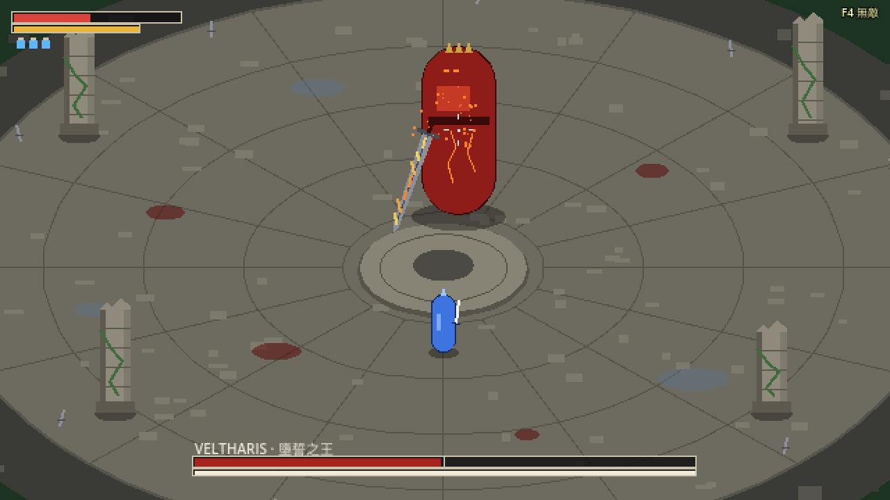

# Rubinite Demo

俯視角 2D 像素動作遊戲的單一 Boss 戰 Demo，用 Godot 4.7（GDScript）製作。
玩家扮演騎士，對上 Boss「維爾薩里斯・墮誓之王」。核心循環是：**讀招 → 劍彈返 → 削韌 → 處決**。



> 上圖是機制階段的佔位圖形；角色與場景的像素美術在 `assets/sprites/`。

## 怎麼玩

1. 用 Godot 4.7 開啟這個資料夾（`project.godot`），按 F5 執行。主場景是 `scenes/levels/combat_arena.tscn`。
2. 開場就是 Boss 戰。死亡後 2 秒自動重來；勝利後按攻擊鍵再戰。

| 動作 | 鍵盤 | 手把（Xbox） |
|---|---|---|
| 移動 | WASD | 左搖桿 |
| 輕攻擊（四段連擊） | J | X |
| 重擊（按住蓄力，放開突刺） | U | Y |
| 格擋（被打中前 0.15 秒內按下＝完美彈返） | K | LB |
| 閃身 | Space | A |
| 奔跑 | Shift（按住） | RB |
| 鎖定／切換目標 | Tab／Q、E | R3／右搖桿 |
| 治療（3 次） | R | B |

除錯鍵（從編輯器執行時）：F1 顯示判定範圍與數值、F2 慢動作、F3 Boss 停止並指定下一招、F4 無敵、F5 重置。

## 架構

- **戰鬥邏輯與畫面分離**：戰鬥是 60Hz 的決定性模擬（`CombatSim`），同一個亂數種子結果完全相同，所以可以在無介面模式下跑單元測試和整場批次模擬。
- **數值全部放在資料裡**：`VeltharisData`、`PlayerData`、`FeedbackData`；Boss 的每一擊是一筆 `BossHitData`。
- **Boss**：兩個階段、霸體、韌性與失衡、處決、懲罰技；第二階段有三斬、雙重衝擊、灰燼迴旋、墜王之躍。
- **自動化驗證**：單元測試、模擬玩家機器人（perfect / human / human_cautious）批次對戰，用來量勝率、勝場時間與破韌節奏。

```
scripts/    遊戲程式（戰鬥模擬、角色、Boss AI、畫面）
scenes/     Godot 場景
assets/     精靈圖、音效
tests/      單元測試與批次模擬
tools/      美術與音效的輔助工具（Python）
docs/       設計文件與開發紀錄
```

## 測試

```bash
tests/check.sh                                                      # lint + 單元測試 + 無介面啟動
godot --headless --path . -s res://tests/sim/run_batch.gd -- --bot=human --games=50   # 批次模擬
```

## 開發紀錄

依里程碑開發（M0 基礎架構 → M6 打擊感與調校），每個里程碑都經過自動測試、截圖驗證、模擬對戰與獨立審查。
目前機制已完成，正在做美術與音效。

- `docs/plan.md`：里程碑與驗收標準
- `docs/combat-design.md`、`docs/boss-veltharis.md`：戰鬥規則、Boss 招式
- `docs/art-progress.md`：美術進度
- `docs/final-report.md`：機制階段的成果與指標（難度目前偏高、勝場時間偏短，原因與調校過程在報告裡）
- `docs/tuning-log.md`：每一次數值調整

## 關於 AI 協作

本專案以 AI 協作開發：遊戲設計、規則與驗收標準由我（簡翊森）訂定，程式碼主要由 AI（Claude）依設計文件實作，再由自動測試、模擬對戰與試玩驗證。`CLAUDE.md` 與 `docs/` 中的開發紀錄保留了完整的協作過程。

第三方素材：`addons/godot_ai`（MCP 外掛，見其 LICENSE）。音效由程式合成（`scripts/audio/`）。
